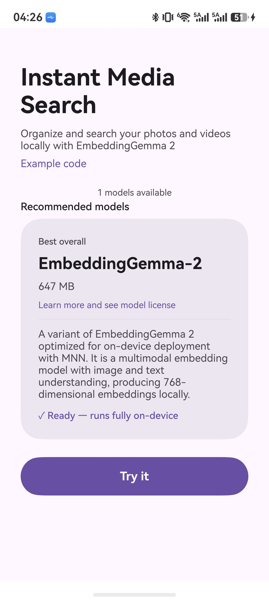
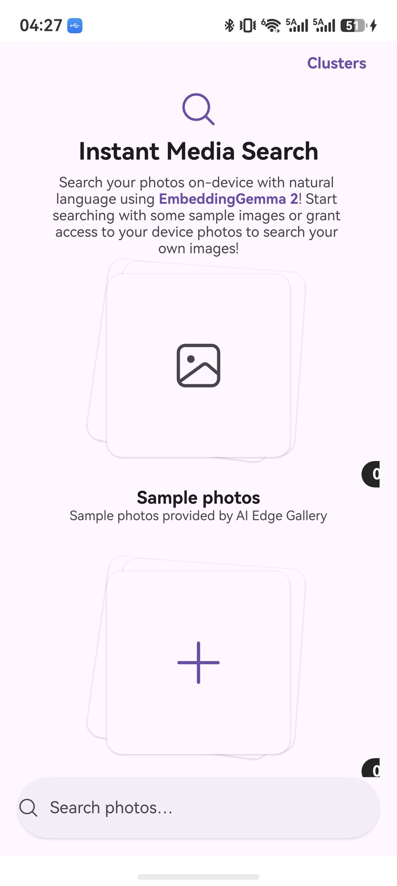
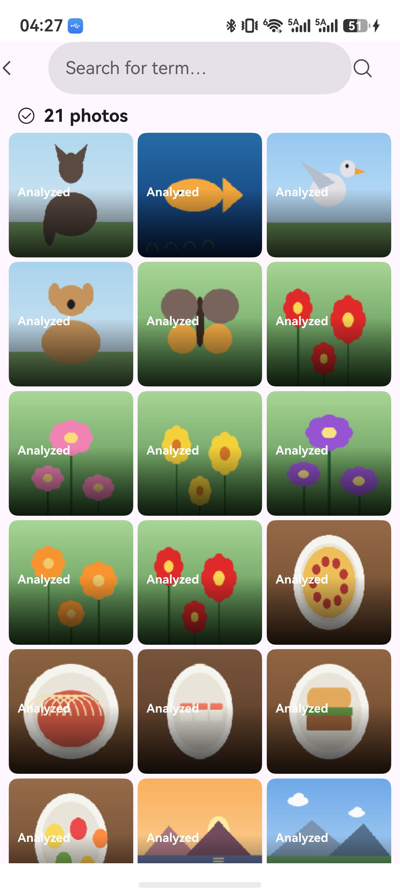
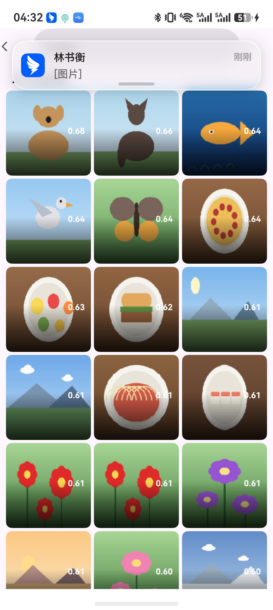
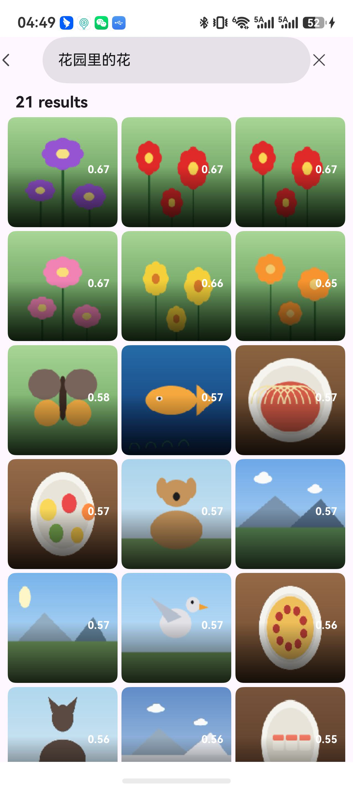
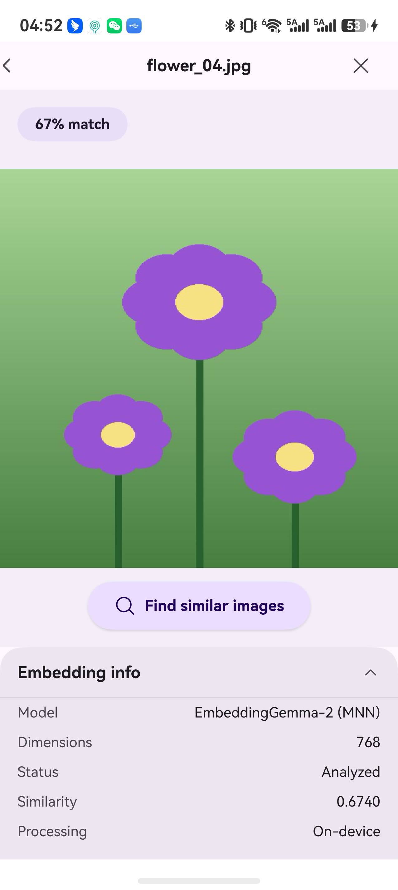
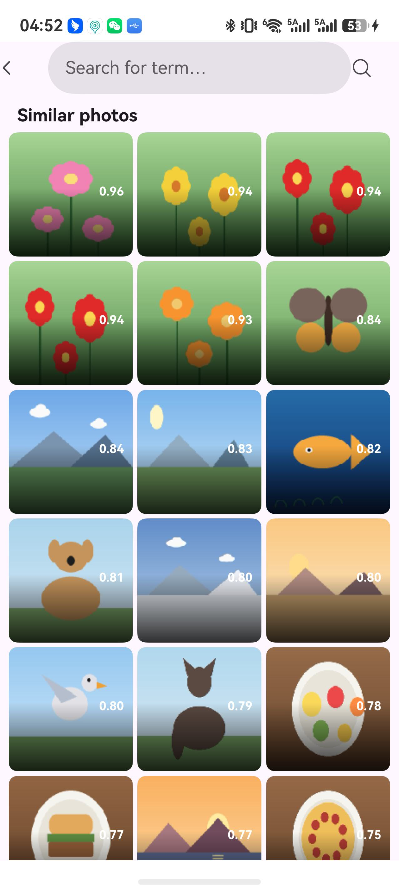
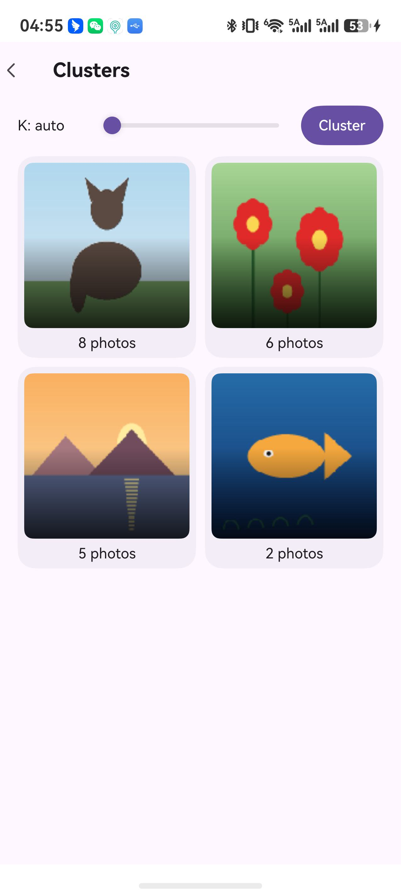

# SemSearch 🔍

[](LICENSE)
[]()
[]()

**探索、体验并评估端侧生成式 AI 的未来 —— 100% 在你的 HarmonyOS 设备上，离线、私有、飞快。**

SemSearch 是一个运行在 HarmonyOS 上的端侧语义照片搜索应用：照片与文本经 **EmbeddingGemma-2** 在设备本地编码为 768 维向量，支持自然语言搜图、图搜图与自动聚类。UI 全流程参照 Google [AI Edge Gallery](https://github.com/google-ai-edge/gallery) Smart Album（Material 3），引擎为自研 D1 优化链路。

## 🎬 Demo

**真机实录**（华为 Pura 80 Pro · Kirin 9020，全程离线）：模型恢复 → 种子导入 → 索引 → 英文/中文语义搜索 → 照片详情 → 图搜图 → 自动聚类。

<video src="docs/demo.mp4" controls muted width="270"></video>

## 📸 App Preview

<p>




</p>
<p>




</p>

## ✨ Core Features

* **语义搜索（Instant Media Search）**：输入即搜（300ms debounce），中英文皆可——"a dog"、"花园里的花" 都能直接命中，结果按相似度降序并标注 `%match`，零云端往返。
* **图搜图（Find similar images）**：照片详情页一键以图检索全库，单图编码 ~1.2s，相似度 0.96 起步精确排序。
* **自动聚类（Clusters）**：K-means 向量聚类，自动 K 或手动 K，语义分组（动物 / 食物 / 风景…）——Google Smart Album 没有的扩展能力。
* **断点续索引**：索引中断可续跑，新增照片只索引增量；1600 张照片约 51 分钟一次性完成。
* **100% 端侧隐私**：所有推理在设备硬件上完成，无需联网，照片、查询与向量不出设备。
* **M3 双主题**：Material 3 浅色/深色模式全量适配，28dp 圆角卡片、pill 按钮、动效曲线逐一对齐 Google 原版。
* **内置示例**：rawfile 自带 21 张 seed 照片，一键导入即可体验完整流程。

## 📊 对比数据

同一台真机（华为 Pura 80 Pro，Kirin 9020）实测，SemSearch D1 引擎 vs Google AI Edge Gallery 官方实现：

| 指标 | **SemSearch (D1)** | Google AI Edge Gallery | 差距 |
|------|-------------------|----------------------|------|
| 索引速度 | **1.91 s/张** | 2.61 s/张 | **快 27%** |
| 视觉 token 预算 | **70 soft tokens** | 280 soft tokens | 1/4 prefill 计算量 |
| 图搜图单次耗时 | **~1.2 s** | 2.6 ~ 4.9 s | **快 2~4×** |
| 文本检索（千级库） | < 1 s | < 1 s | 持平 |
| 索引可恢复 | ✅ 断点续跑 | ⚠️ 依赖 DB 去重 | — |
| 自动聚类 | ✅ 自动 K | ❌ | 扩展能力 |
| 中文查询 | ✅ | ✅ | 持平 |
| 量化方案 | int8 权重 + bf16 嵌入表 | int8 | 混合精度 |

> 注：Google 侧数据在卓易通容器内以 uitest 自动化实测（T038 基准），容器开销可能贡献部分差距；两者均使用 EmbeddingGemma-2 768 维模型，索引集与硬件完全相同。

1600 张照片估算：**D1 约 51 分钟**，Google 栈约 70 分钟。

## 🏆 核心贡献

1. **视觉 token 预算裁剪（主优化）**：`vision_soft_token_budget` 280 → 70。LLM prefill 计算量随 soft token 数线性增长，裁剪至 1/4 直接砍掉端侧最大计算开销；经自检基准（花 0.7174 / 狗 0.5698）与中英文检索、聚类、图搜图全链路验证，嵌入质量保持在可用区间。
2. **混合精度量化**：计算密集的 GEMM 走 int8（4× 内存带宽节省），查表密集的 LLM 嵌入表保留 bf16（`embeddings_bf16.bin` 256MB），兼顾速度与嵌入保真度。
3. **MnnGate 并发门控**：taskpool 推理任务串行过闸，杜绝端侧并发推理导致的 CPU 争抢与 appfreeze——实测全程零冻结。
4. **ArkUI 全链路复刻**：在 ArkTS/ArkUI 上手工复刻 Material 3 Smart Album 全流程（懒加载网格、PhotoStack、docked 搜索栏、详情覆盖层、深色模式），并扩展 Google 没有的聚类视图。
5. **可复现基准方法论**：uitest 自动化驱动真机逐屏验证 + 容器内 Google 官方栈对照实测，全部数据可复现（spec 驱动开发 T001–T044）。

## 🛠️ Technology Highlights

* **HarmonyOS ArkTS / ArkUI**（API 26）：单页状态机 + Navigation，V1 状态管理，taskpool 多线程。
* **NAPI + C++**：`libentry.so` 直连 MNN `Embedding` 推理引擎，无框架层开销。
* **MNN（Alibaba）**：端侧推理框架，CPU 4 线程 + int8 + low precision 运行时。
* **EmbeddingGemma-2（Google）**：768 维多模态嵌入模型，视觉塔 + 70 soft token 预算。
* **K-means 聚类**：纯端侧向量聚类，自动 K 估计。
* **ThumbCache**：全局缩略图缓存（inflight 去重 + 容量上限淘汰），网格滚动零重复解码。

## 🏁 Get Started

1. **环境要求**：DevEco Studio（HarmonyOS SDK，API 26）+ JDK 21。
2. **模型权重**（必需）：GitHub 单文件上限 100MB，以下权重已从仓库排除，构建前需放置到 `entry/src/main/resources/rawfile/eg2v_int8/`：

   | 文件 | 大小 |
   |------|------|
   | `embedding.mnn.weight` | 156 MB |
   | `visual.mnn.weight` | 215 MB |
   | `embeddings_bf16.bin` | 256 MB |

   同目录其余文件（`*.mnn`、`tokenizer.mtok`、`config.json` 等）均已入库。也可不走打包：在 PC 上 `python -m http.server 8000` 起服务，改 `Index.ets` 的 `baseUrl` 为 PC 局域网地址，应用内"Download via HTTP"即可下载（需同一网络）。
3. **构建**：IDE 内 Build > Build Hap(s)，或：

   ```bash
   hvigorw assembleHap --mode module -p product=default
   ```

4. **运行**：

   ```bash
   hdc install -r entry/build/default/outputs/default/entry-default-signed.hap
   hdc shell aa start -a EntryAbility -b com.example.semsearch
   ```

   含权重 HAP 约 655MB；首启从 rawfile 流式恢复模型（无需下载）。

## 📁 工程结构

```
entry/src/main/
├── cpp/                    # native：MNN 推理封装（embedding_napi.cpp → libentry.so）
├── ets/
│   ├── pages/
│   │   ├── Index.ets       # Google 风格任务介绍页（模型卡、rawfile 恢复进度、Try it）
│   │   └── Album.ets       # SmartAlbum 落地页 + 搜索 + 详情 + 图搜图 + 聚类（单页状态机）
│   └── common/
│       ├── MnnGate.ets     # 推理并发门控
│       ├── EmbedTasks.ets  # taskpool 任务：init/imgEmbed/visualInit
│       ├── RawInstaller.ets# rawfile → 沙箱流式恢复
│       ├── PhotoIndexManager.ets  # 照片索引/向量库/聚类/增量同步
│       └── ThumbCache.ets  # 全局缩略图缓存
└── resources/
    ├── base|dark/element/color.json  # M3 双主题色板
    └── rawfile/            # 模型 + 21 张 seed 照片
```

## 📄 License

- 应用源代码：[Apache-2.0](LICENSE)，Copyright 2026 yphou
- 第三方组件（MNN、EmbeddingGemma-2 模型、Google AI Edge Gallery UI 参照）权利归各自所有者，见 [THIRD_PARTY_NOTICES.md](THIRD_PARTY_NOTICES.md)；模型权重的使用须遵守 [Gemma Terms of Use](https://ai.google.dev/gemma/terms)

## 🔗 Useful Links

* [Google AI Edge Gallery](https://github.com/google-ai-edge/gallery) — UI 参照原版
* [MNN](https://github.com/alibaba/MNN) — 端侧推理框架
* [EmbeddingGemma 2](https://developers.googleblog.com/google-ai-edge-with-embeddinggemma-2/) — 多模态嵌入模型
* [HarmonyOS 开发者](https://developer.huawei.com/consumer/cn/) — 平台文档
